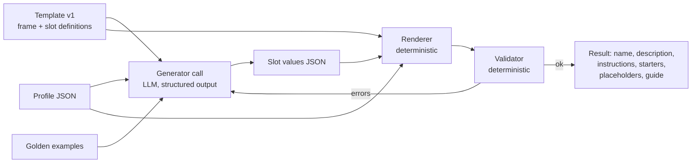
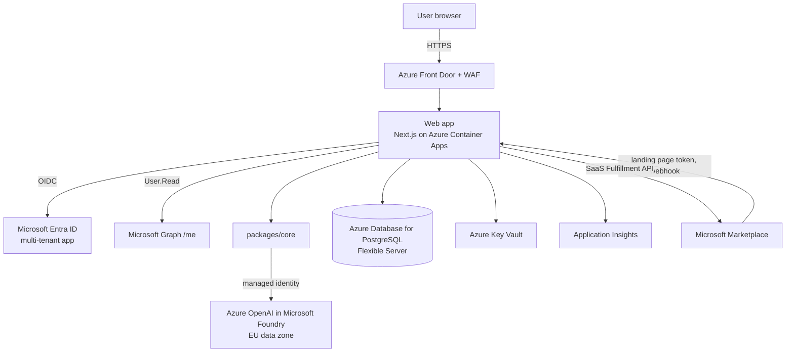

# Architecture

## Current delivery path (ADR-001)

Decided 2026-11-18, see `docs/adr/ADR-001-company-power-platform.md`.

- The product is delivered to **one company** as a Power Platform solution: interview agent, prompt tool `GenerateEmailTriageSlots`, agent flow `RenderAndValidate`, feedback table. It is built in the company's test environment and moved to production by the company's IT (managed solution).
- Model calls happen only inside Copilot Studio. No own Azure subscription and no own Azure OpenAI. Evals are run by hand in the test environment.
- The design in § 1 and § 2 still applies. The agent flow implements the renderer and validator (§ 2, last paragraph). `packages/core` is the reference and test oracle, not a deployed service. The model client stays in the repository, unused in this path.
- **§ 3 (Phase 2 SaaS architecture) and § 4 (Phase 3 app package export) are deferred.** They are kept for a later decision and do not describe the current product.

## 1. Core idea: deterministic frame, LLM content

The generator never writes the whole instruction text. The LLM fills only the role-specific **slots** of a fixed, versioned template. Code renders the template and validates the result.

Why:
- The guardrails (read-only, prompt-injection rule, facts-only rule, self-check) cannot disappear, because the LLM never touches the fixed text.
- Length stays under control: each slot has a character limit, the frame has a known length.
- Quality is testable: golden examples render byte-identical; changes to the frame are visible in code review.
- New agent types are new templates, not new code paths.

## 2. Shared core (all phases)

`packages/core` (TypeScript, no framework dependencies) contains:

| Module | Responsibility |
|---|---|
| `profile` | Types and runtime validation (zod) generated from `schemas/agent-profile.schema.json`. Normalization (trim, deduplicate, defaults). |
| `templates` | Loads `templates/<id>/<version>/template.json` and the body. Template registry with versions. |
| `computed` | Computes the `computed` slots from the profile (language names, keyword packs, labels). |
| `renderer` | Fills slots, applies `line_optional` and `inline_optional` rules. Must match `reference/composer_ref.py` exactly. |
| `validator` | All checks from `docs/04-generation-and-validation.md`. Returns errors and warnings. Must match the reference. |
| `generator` | Builds the model request (system prompt, template, examples, profile), calls the model with structured output, parses and returns the generator output. Retries once with validator errors. |
| `guide` | Renders the personal setup guide (HTML and Markdown) from the result. |

The phase 1 pilot uses the same prompt, template and examples files. Its rendering and validation run in an agent flow (see `docs/05-mvp-copilot-studio.md`); the golden tests prove that it gives the same output as the core.

## 3. Phase 2 SaaS architecture (Azure)

### Technology decisions

| Decision | Choice | Reason |
|---|---|---|
| Language | TypeScript (strict) end to end | One language for UI, API and core; best support by coding agents; shared types. |
| Repo | pnpm monorepo: `apps/web`, `packages/core`, `packages/evals`, `infra/` | Clear module borders; core is testable alone. |
| Web | Next.js (App Router), server actions and route handlers for the API | One deployable unit in phase 2a. Split the API later only if needed. |
| UI | React, Fluent UI React v9 | Microsoft look and feel; accessibility built in. |
| Auth | Microsoft Entra ID multi-tenant, MSAL Node; scope `openid profile User.Read` | Required for Marketplace SaaS; no admin consent needed. |
| LLM | Azure OpenAI in Microsoft Foundry, EU data zone deployment, structured outputs with the generator-output schema | EU residency and enterprise terms. If the API rejects schema keywords in strict mode (for example `maxLength`), remove them from the request schema and enforce them in the validator. |
| Model choice | Configuration value per environment; start with the current general-purpose GPT model available in the EU data zone; temperature 0.2 | Model changes are frequent; evals decide upgrades. |
| Database | PostgreSQL Flexible Server, Prisma ORM, row-level tenant filter in the data layer | Relational data (tenants, subscriptions, profiles, versions). |
| Hosting | Azure Container Apps, two environments (staging, production), region West Europe or Sweden Central | Simple scaling; no cluster to operate. |
| Infra as code | Bicep in `infra/`, deployed by GitHub Actions with OIDC federation | Azure-native; no long-lived secrets. |
| Observability | OpenTelemetry SDK to Application Insights | Standard; content-free logs (NFR-8). |
| Tests | Vitest (unit), Playwright (end to end), eval runner in `packages/evals` | Fast feedback; evals are separate because they cost money. |

### Data model (phase 2a)

| Table | Key fields | Notes |
|---|---|---|
| `tenant` | id, entra_tenant_id, name, plan, created_at | One row per customer tenant. |
| `user_account` | id, tenant_id, entra_object_id, display_name, locale | Created on first sign-in. |
| `profile` | id, tenant_id, user_id, template_id, data (jsonb, encrypted at rest), updated_at | `data` follows the profile schema. |
| `generation` | id, profile_id, template_version, prompt_version, model_deployment, status, slots (jsonb), result (jsonb), validator_report (jsonb), latency_ms, tokens_in, tokens_out, created_at | Immutable; versions for the diff view. |
| `feedback` | id, generation_id, rating_relevance, rating_drafts, comment, created_at | |
| `org_context` (2b) | tenant_id, data (jsonb), updated_by | Set by tenant admins. |
| `workspace` (2b) | id, owner_user_id, client_name, branding (jsonb) | Consultant workspaces. |
| `marketplace_subscription` (2b) | id, tenant_id, offer_id, plan_id, status, quantity | Synced by webhook and fulfillment API. |

All queries filter by `tenant_id` from the signed-in user's token. Never accept `tenant_id` from the client.

### API surface (route handlers)

| Method and path | Purpose |
|---|---|
| `GET /api/me` | Current user, prefill from Graph. |
| `GET/PUT /api/profiles/:id` | Read and save a profile (validated against the schema). |
| `POST /api/profiles/:id/extract` | Job description text in, proposed profile fields out (FR-2). |
| `POST /api/profiles/:id/generate` | Generate, render, validate; returns the generation. |
| `PATCH /api/generations/:id/placeholders` | Save filled placeholders; re-validate. |
| `GET /api/generations/:id/export?format=md|html|pdf` | Export. |
| `POST /api/generations/:id/feedback` | Feedback (FR-20). |
| `POST /api/marketplace/webhook` | Marketplace events (2b). |
| `GET /landing` | Marketplace landing page (2b). |

## 4. Phase 3: app package export

Generate a Microsoft 365 app package (zip) with `manifest.json` and a declarative agent manifest (`declarativeAgent.json`) using the latest schema version at build time. Use the `Email` capability; where the schema allows it, scope to folders or a shared mailbox, which Agent Builder cannot do. The instructions field is the rendered instructions. The admin uploads the package. Check the current schema before implementing: newer versions add email write capabilities, which this product must not enable by default.

## 5. Extensibility

- A template is a folder `templates/<id>/v<major>/` (exact version in `template.json`) with `template.json`, a body file, golden examples and eval cases. No code change is needed for a new template unless it introduces a new computed slot.
- Template versions are immutable after release. A fix raises the version in `template.json` (a breaking change gets a new `v<major>` folder); old generations keep their version.
- Prompt files have a version header comment and are stored per generation (NFR-9).
